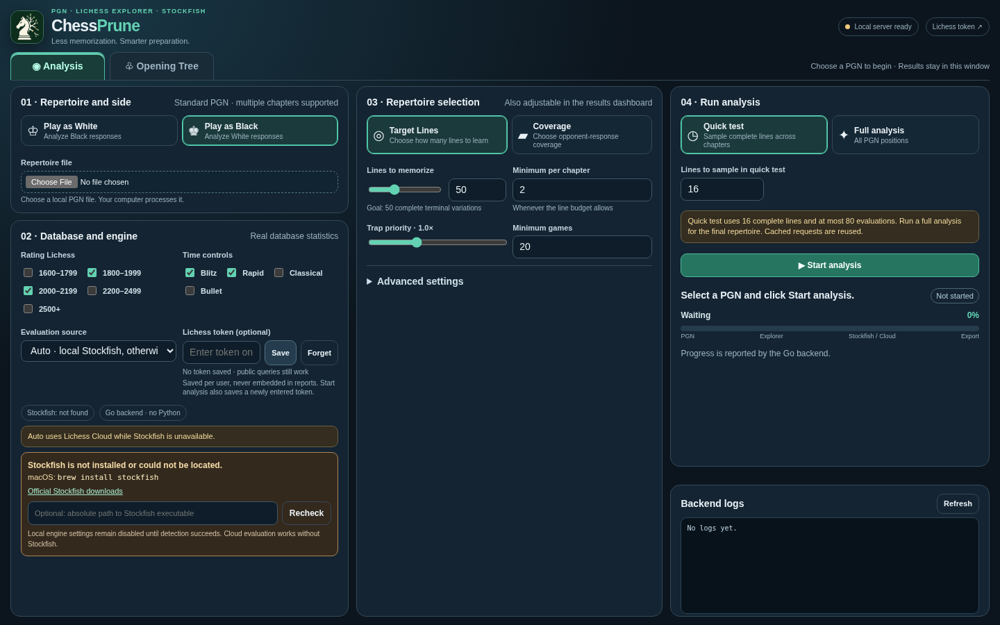
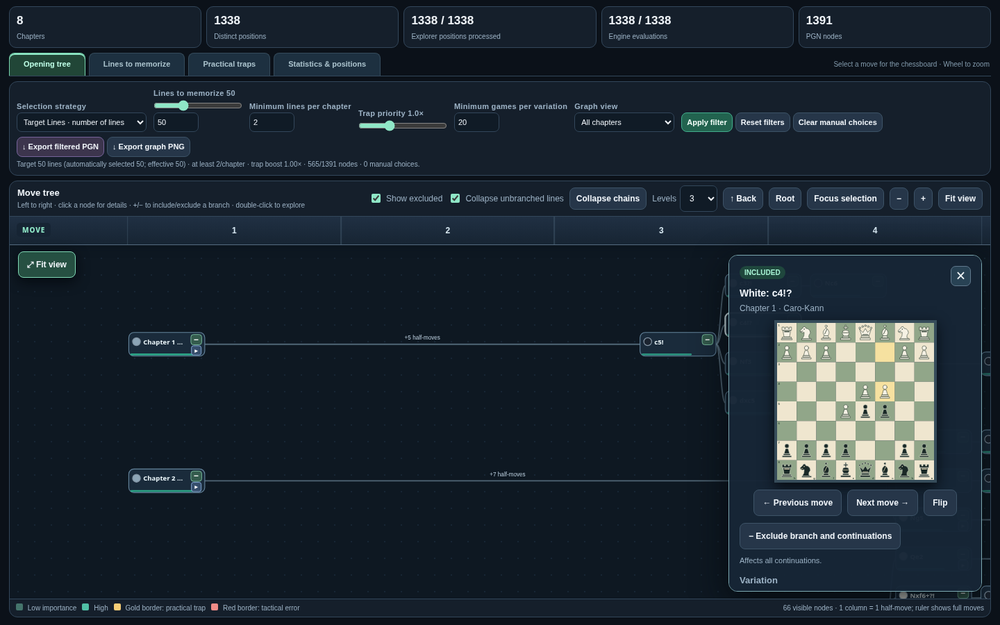
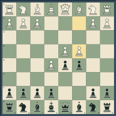

<p align="center"></p>

# ChessPrune

**Less memorization. Smarter preparation.**

ChessPrune is an open-source **Go desktop application** for pruning chess-opening PGN repertoires. It combines Lichess Opening Explorer statistics with optional Lichess Cloud or local Stockfish evaluations, then selects lines worth studying using either a target number of terminal variations or a coverage threshold. No Python runtime or pip installation is needed.

## Screenshots

**Analysis** — import PGN chapters, select the repertoire side, Lichess rating/time-control filters, evaluation source, target lines or coverage, and optionally save a Lichess token.



**Opening Tree** — inspect positions in a single-window tab, adjust selection, navigate branches, compare statistics and evaluations, and export PGN/CSV/PNG. The inspector uses a fixed-size SVG board with vector pieces and no layout shifts.



**Position inspector board** — squares remain identical when a piece moves or when the board is flipped.



*Screenshots illustrate the interface with a sanitized offline example and illustrative local environment statuses; they do not represent a new live Lichess analysis.*

## Install / run

Get a portable executable or installer from [GitHub Releases](https://github.com/MrPiada/ChessPrune/releases/latest).

| OS | Packages | Launch |
| --- | --- | --- |
| macOS Apple Silicon / Intel | `.zip`, `.dmg` | Open `ChessPrune.app` |
| Windows x64 | `.zip`, optional `-Setup.exe` | Run `ChessPrune.exe` |
| Ubuntu / Linux x64 or ARM64 | `.tar.gz` | Run `./ChessPrune`; optional desktop launcher in the archive |

The app embeds its frontend and its chess-piece artwork, starts a loopback-only server and opens a browser tab.

### Closing the application

**Quit application** in the top-right corner stops ChessPrune, not just its browser tab. Closing the **last ChessPrune browser tab/window** also shuts down the Go server automatically after a **six-second grace period**, which prevents an ordinary refresh from accidentally quitting. Multiple open ChessPrune tabs keep the server running until the last one closes. Any active analysis is cancelled when the application exits; previously written results remain in the per-user analysis folder.

This uses a persistent, same-origin browser-to-server connection (Server-Sent Events) rather than unreliable background-tab polling. A brief network interruption may count as closing the tab if the stream cannot reconnect within the grace period. **Headless mode** (`--no-browser`) intentionally disables automatic browser-close shutdown: stop the terminal process with **Ctrl+C**. ChessPrune uses your regular browser, so closing the application does not close unrelated browser windows or quit Chrome/Safari/Firefox.
 The downloaded HTML dashboard also contains its own board images and works offline. Native release builds are **not notarized or signed with a commercial code-signing identity**; operating systems may display a warning.

### Stockfish

ChessPrune works without Stockfish using Lichess Cloud or statistics-only analysis. To enable local engine evaluation:

- **macOS:** `brew install stockfish`
- **Windows:** `winget install --id Stockfish.Stockfish -e`, or download from [stockfishchess.org](https://stockfishchess.org/download/)
- **Ubuntu:** `sudo apt update && sudo apt install stockfish` (often `/usr/games/stockfish`)

Click **Recheck** in the Analysis tab. Local-only options are disabled while the engine is unavailable. Stockfish itself is **not bundled**.

## Optional persistent Lichess token

Public Opening Explorer and Cloud queries generally need no token. If you use one, enter it in **Analysis → Database and engine → Lichess token** and click **Save**. You can also enter it immediately before **Start analysis**; ChessPrune will save it then. **Forget** removes the saved token. It persists across application restarts and upgrades for the same OS account.

- **macOS:** saved in the user's **Keychain** under `com.chessprune.lichess-token`. The native `security` utility briefly receives the token as a process argument when saving it.
- **Windows / Linux:** saved in a **user-private settings file**, *not encrypted at rest*. Owner-only file permissions are requested where supported.
- The `LICHESS_TOKEN` environment variable, if present, takes precedence over the saved value.

The backend **never returns the token to the web page**, writes it into report files, or forwards it to `explorer.lichess.org`; authenticated requests are restricted to HTTPS at `lichess.org`. Avoid committing credentials to Git or granting unnecessary token privileges. The web UI runs only on `127.0.0.1`.

## Build and test from source

Requirements: **Go 1.23+**. For local evaluation, install Stockfish separately.

```bash
go test ./...
go vet ./...
go run .
```

A CLI mode is also supported: `go run . --analyze repertoire.pgn --side black --out results`. The GUI supports canceling a running analysis; large opening trees and very deep engine evaluations may take a while.

**Cross-compile all packages directly on macOS** (Windows x64 and Ubuntu targets do not require a Windows/Linux compiler):

```bash
brew install go gh python makensis
chmod +x scripts/build-release.sh
./scripts/build-release.sh v1.2.0-go
```

The script builds Apple Silicon and Intel `.app` ZIPs (and `.dmg` files on macOS), Windows `.exe` ZIP (with optional NSIS Setup installer), and Linux x64/ARM64 `.tar.gz`. Files and SHA-256 checksums appear in `dist/`. The native app icons remain unchanged from ChessPrune's repository branding.

**To publish from an existing local clone** after testing, commit and push changes, tag `v1.2.0-go`, then attach release assets:

```bash
git add -A && git diff --cached --check
git commit -m "ChessPrune v1.2.0-go: persistent token and stable SVG board"
git push origin main
git tag -a v1.2.0-go -m "ChessPrune v1.2.0-go"
git push origin v1.2.0-go
gh release create v1.2.0-go dist/ChessPrune-v1.2.0-go-* dist/SHA256SUMS.txt \
  --verify-tag --title "ChessPrune v1.2.0-go" \
  --notes-file RELEASE_NOTES_v1.2.0-go.md --latest
```

## Notes

ChessPrune supports standard chess PGNs and multiple chapters. Lichess statistics are filtered samples and Stockfish/Cloud assessments are evaluations, not proofs. This software is not affiliated with Lichess or Stockfish. Development and documentation were assisted by ChatGPT.

MIT license; see [LICENSE](LICENSE).
